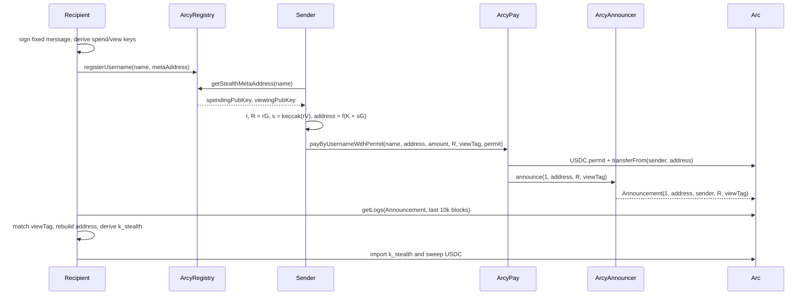

# Architecture

arcy.me is a static React app plus three Solidity contracts on Arc. There is no backend: usernames,
stealth meta-addresses, payments, and announcements all live onchain, and key derivation happens in the
browser.

## Components

```
+-------------------+          +--------------------+          +--------------------+
| ArcyRegistry.sol  |          | ArcyPay.sol        |          | ArcyAnnouncer.sol  |
|-------------------|          |--------------------|          |--------------------|
| username -> owner |  read    | permit + transfer  |  call    | validate 33-byte R |
| username -> meta  |<---------| announce(payment)  |--------->| emit Announcement  |
| release / update  |          | emit PaymentSent   |          |                    |
+-------------------+          +--------------------+          +--------------------+
        ^                              ^                              |
        | register                     | pay                          | logs
        |                              |                              v
+-----------------------------------------------------------------------------+
| React app (Vite)                                                            |
| RegisterView  PayView  ScanView  AccountView   stealth.ts   contracts.ts     |
+-----------------------------------------------------------------------------+
```

### ArcyRegistry

Permissionless username registry. One username per address; usernames are 1–32 characters of
lowercase `a-z`, `0-9`, and `-`, and must start and end with a letter or number.

| Function | Description |
|---|---|
| `registerUsername(string,bytes)` | Claims a username and stores a 132-byte stealth meta-address |
| `updateStealthMetaAddress(bytes)` | Rotates the caller's meta-address |
| `releaseUsername()` | Frees the caller's username |
| `transferUsername(address)` | Starts a two-step transfer to another wallet |
| `acceptUsername(string)` | Completes a pending transfer as the recipient |
| `cancelUsernameTransfer()` | Cancels the caller's pending transfer |
| `getStealthMetaAddress(string)` | Reverts `UsernameNotFound` when unregistered |
| `getUsername(address)` / `getOwner(string)` | Reverse and forward lookups |
| `getPendingOwner(string)` | Pending transfer recipient, or `address(0)` |
| `isUsernameAvailable(string)` | Validates format and checks ownership |

State is four mappings keyed by `keccak256(username)`: owner, meta-address, pending transfer owner,
and the reverse username per address. Usernames can move between wallets without releasing them;
releasing clears the pending transfer as well.

### ArcyAnnouncer

Minimal ERC-5564 style emitter. `announce` validates that the ephemeral public key is exactly 33 bytes
with a compressed prefix (`0x02` or `0x03`) and then emits:

```solidity
event Announcement(
    uint256 indexed schemeId,
    address indexed stealthAddress,
    address indexed caller,
    bytes ephemeralPubKey,
    bytes1 viewTag
);
```

There is intentionally no variant that records the recipient username, because that would link the
payment to the username and break the privacy model.

### ArcyPay

Payment router that makes funding and announcing atomic. Holds no funds and has no owner.

| Function | Description |
|---|---|
| `payByUsername(...)` | Requires a registered username, transfers USDC from the payer, announces with `schemeId = 1` |
| `payByUsernameWithPermit(...)` | Same, but calls EIP-2612 `permit` first so no separate approval transaction is needed |

Both revert on `ZeroAmount`, `ZeroAddress`, or a failed `transferFrom`, and emit
`PaymentSent(sender, stealthAddress, amount)`. The permit variant tolerates a permit that was already
consumed (front-run) as long as the existing allowance covers the amount, otherwise it reverts with
`PermitFailed`.

The USDC address (`0x3600...0000`) is a compile-time constant, so a redeployment is required for a
different token or chain.

## Key derivation

Stealth keys are deterministic functions of a wallet signature. Two derivations exist, selected by the
version byte in the registered meta-address:

| Version | Message | Entropy |
|---|---|---|
| `0` (legacy) | `STEALTH_KEY_DERIVATION_MESSAGE_V1` | `sig[0..32]` |
| `2` (current) | `stealthKeyDerivationMessage(2, chainId)` | `keccak256(sig || "arcy.me/stealth-key/v2/" || chainId)` |

The v2 message embeds the app domain, chain id, and purpose, so a signature for another application or
chain cannot be replayed here. The rest of the derivation is shared:

```
spendScalar = keccak256("spend" || entropy) mod (n - 1) + 1
viewScalar  = keccak256("view"  || entropy) mod (n - 1) + 1
```

`spendingPubKey` and `viewingPubKey` are the compressed public keys of those scalars. Because the
derivation is deterministic, losing browser storage does not lose funds as long as the wallet can sign
the same message again.

The signature is still the key material: anyone who obtains it can recreate the spending key. The UI
states this on every signing surface, and the Account view can upgrade a legacy registration to v2
through `updateStealthMetaAddress`.

### Meta-address encoding

ERC-5564 specifies a 66-byte meta-address (`spendingPubKey || viewingPubKey`), but `ArcyRegistry`
enforces 132 bytes. The app encodes 66 real bytes, 65 zero padding bytes, and a version byte at index
131. The contract validates both compressed prefixes, requires padding `66..130` to be zero, and only
accepts version `0` or `2`. This is a known deviation from the EIP; changing it requires a contract
upgrade and a migration path for existing registrations.

## Payment derivation (sender)

Given spending public key `K`, viewing public key `V`:

```
r  <- random scalar                       ephemeral private key, never leaves the browser
R  = r·G                                  ephemeral public key, published in the announcement
s  = keccak256(compress(r·V))             shared secret
S  = K + (s mod n)·G                      stealth public key
address = last20(keccak256(S[1..]))       stealth address, funded by the payment
viewTag = s[0]                            single-byte filter for scanning
```

`R` and `viewTag` are passed to `ArcyPay`, announced by `ArcyAnnouncer`, and required for the recipient
to detect and claim the payment.

## Detection and claiming (recipient)

For each `Announcement` log:

```
s'       = keccak256(compress(viewingPrivKey·R))
viewTag' = s'[0]                          reject when it differs from the announced viewTag
S'       = K + (s' mod n)·G
address' = last20(keccak256(S'[1..]))     accept when it equals the announced stealthAddress
k_stealth = (spendingPrivKey + s' mod n) mod n
```

`ScanView` scans the last 10,000 blocks in 2,000-block chunks, with an opt-in full-history mode that
starts at block 0. It tolerates rate limits with retry and backoff, skips ephemeral keys without a
valid compressed prefix, and wraps every per-announcement check in `try/catch` so one malformed
announcement cannot abort the scan. Claiming copies `k_stealth` to the clipboard; the user imports it
into a wallet and transfers the USDC out. The app never signs with the stealth key.

## Sequence



## Frontend data flow

- `src/contracts.ts` exports addresses, chain IDs, USDC constants, and ABIs imported from `src/abi/*.json`.
- `src/config.ts` creates the wagmi client for Arc Testnet plus Ethereum mainnet (mainnet is only used
  for ENS resolution).
- `src/stealth.ts` contains the whole secp256k1 implementation: encode/decode meta-address, generate,
  check, derive claim keys, and the deterministic key derivation from a signature.
- `src/App.tsx` routes `/` (landing), `/<username>` (public pay page), `/app`, `/app/setup`,
  `/app/claim`, and `/app/account` with the History API, so no server rewrites other than the SPA
  fallback in `vercel.json` are required.
- `PayView` derives the stealth address first and shows a review card with the address and amount
  before any wallet prompt.
- `AccountView` upgrades legacy keys to v2 and manages two-step username transfers.
- `src/onchain-facts.ts` and `src/onchain-money.ts` provide chain metadata, explorer URL builders, and
  exact USDC amount parsing/formatting.
- `src/tracing.ts` and `src/console-capture.ts` are development instrumentation used by Arc Studio.
  They patch `fetch`, `window.ethereum.request`, and `console` and are safe to remove for production
  hardening.

## Trust model

- `ArcyPay` trusts the sender-supplied `stealthAddress` and `ephemeralPubKey`. It does not verify the
  derivation onchain; the recipient verifies it locally during scanning. A malicious sender can
  therefore pay an arbitrary address, but cannot make it appear as a payment to someone else.
- The registry owner mapping is public. Privacy depends on payments never referencing the owner
  address, which is enforced by the app and by `ArcyPay` never reading the owner.
- Stealth keys are only as safe as the wallet signature. A wallet that produces non-deterministic
  signatures will derive different keys and cannot recover previous payments, and a leaked signature
  gives full access to stealth funds. Domain separation in v2 and explicit warnings reduce, but do not
  eliminate, that risk.
- Anyone can emit announcements through `ArcyAnnouncer`. Scanning must verify each announcement
  cryptographically, which `checkStealthAddress` does.

## Limitations

- No onchain stealth-address verification, by design, to keep payments cheap and simple.
- Scanning defaults to a recent block window; older payments require the full-history option or an
  indexer. Payments received before a v1 to v2 key upgrade are not found by a v2 scan.
- Amounts, sender, and timing are public.
- One username per address; rotating usernames requires releasing the old one first.
